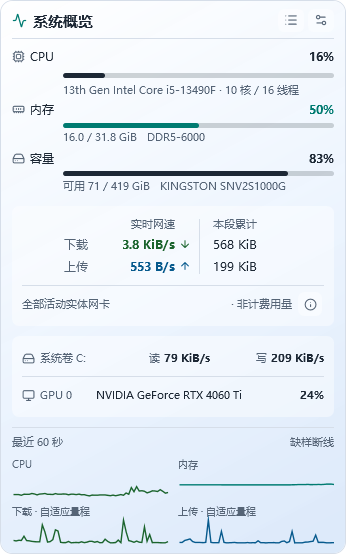
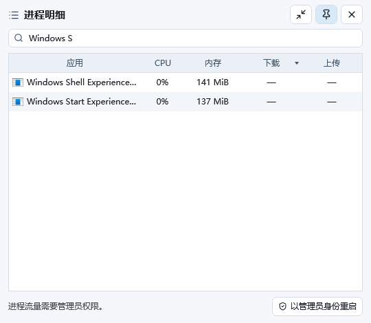
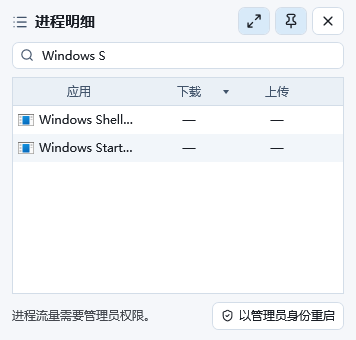

# SysPulse

SysPulse 是一款面向 Windows 11 x64 的轻量任务栏监控工具，显示整机下载、上传、CPU 和内存占用。项目使用 C#、WPF 和 .NET 10，发布为免安装的单文件程序。

[下载最新版](https://github.com/Meill2486/SysPulse/releases/tag/v0.5.4) · [界面效果](#界面效果) · [构建与运行](#构建与运行)

## 界面效果

以下展示 **Light 配色的真实 WPF 窗口与实时数据**，不是设计稿。截图使用独立配置、Windows 11、100% 缩放；仅采集程序区域，并为透明像素统一使用浅色衬底，方便在不同 GitHub 主题下查看。硬件与动态读数来自截图时的本机，不代表固定数据或性能承诺。点击图片可查看原图。

### 任务栏监控条：透明优先，也可显示气泡背景

首次启动默认 **内存｜网速｜CPU**，背景完全透明；已有配置中的自定义顺序会保留。下载在上、上传在下，显示项、标签、图标和指标顺序可独立设置。下图启用了内置图标以便区分指标。

| 布局 | 透明背景 | 不透明气泡背景 |
| --- | --- | --- |
| 环形 + 双行 |  |  |
| 双行分组 |  |  |
| CPU / 内存单行 |  |  |

透明模式保持紧凑；显示气泡背景时，内容与描边之间留出对称内边距，气泡上下也与任务栏窗口边界保持留白。三种布局共用这套规则，读数更新不会推动模块边界。

### 系统概览：整机状态、硬件与趋势

点击监控条的 **CPU 或内存区域** 打开概览，再次点击收起。这里可以查看：

- CPU、物理内存占用及可用的硬件规格；
- 系统卷容量与实时读写、各 GPU 利用率；
- 实时上下行、本统计段累计流量和最近 60 秒趋势。



硬件信息按需读取，未知或失败读数显示「—」；窗口空间不足时，指标区可滚动，不裁掉底部趋势。

### 进程明细：搜索、排序与简化模式

点击 **网速区域** 或概览的进程按钮打开。完整模式展示应用、CPU、内存及上下行；支持搜索、按列排序、固定窗口，以及右键查看/复制路径、复制 PID 和打开所在文件夹。

| 完整模式 | 简化模式 |
| --- | --- |
|  |  |

为避免公开无关应用信息，截图用内置搜索 `Windows S` 筛选了 Windows Shell/Start 系统组件。截图以普通权限运行，进程流量显示 **「—」**，不是零流量；实际进程流量需要按需授予管理员权限。简化按钮用于切换窄窗口，固定按钮用于在点击外部后继续保留窗口。

设置入口位于托盘或右键菜单，布局、主题、透明度、刷新间隔、阈值、网络范围和自启均可自行调整；这里不重复展示设置页和其他主题。

## 使用方式

1. 从 [GitHub Releases](https://github.com/Meill2486/SysPulse/releases) 下载 `SysPulse-v<版本>-win-x64.zip`，不要下载自动生成的 Source code 源码包来运行。
2. 解压到当前用户可写的独立目录，运行 `SysPulse.exe`，无需安装 .NET。当前版本为 `v0.5.4`。
3. 程序默认以普通权限运行，监控条贴在主屏任务栏右侧、通知区域的折叠箭头左边；默认顺序为内存｜网速｜CPU，背景完全透明。

当前公开包未进行代码签名，Windows 可能显示 SmartScreen 或未知发布者提示；请核对下载来源和同页的 `SHA256SUMS.txt`，不要关闭系统安全防护。可用 PowerShell 执行 `Get-FileHash .\SysPulse-v0.5.4-win-x64.zip -Algorithm SHA256` 校验压缩包。

升级时先从托盘退出旧程序，再用新 EXE 替换旧 EXE，保留同目录的 `SysPulse.json`。公开 ZIP 不包含个人配置。删除程序目录即可移除文件；删除前请先关闭开机自启。

| 操作 | 结果 |
| --- | --- |
| 点击 CPU 或内存 | 打开蓝雾概览：整机指标、系统卷容量/读写、各 GPU 利用率、网络本段累计和最近 60 秒趋势。硬件规格按需读取。 |
| 点击网速 | 进程明细支持搜索、排序、固定、简化模式，以及右键查看/复制路径、复制 PID、打开所在文件夹。进程流量按需申请管理员权限。 |
| 点击托盘图标 | 打开设置，调整显示、排序、深浅配色、刷新、阈值，以及开机自启和启动提权。 |
| 右键监控条或托盘图标 | 打开各自的快捷菜单，可隐藏监控条或退出程序。 |

点击任务栏空白或展开隐藏图标时，监控条保持显示；空位不足或安全几何过期时仍会暂时收起，仍可从托盘打开设置。正式支持 Windows 11 x64、主屏系统原生水平任务栏；不再维护 Windows 10、竖向或替换式旧任务栏。

系统概览固定蓝雾玻璃外观，支持深色、浅色或跟随系统；布局、图标、指标顺序独立设置。GPU/I/O 不加入任务栏。容量、流量统一使用 1024 进制 KiB/MiB/GiB。
概览超出主屏工作区时，标题和快捷操作仍可见，指标区可滚动。

进程明细在滚轮、翻页或拖动期间继续后台采样，暂缓列表合并；滚动空闲 250ms 且松开鼠标后显示最新快照，不回放旧数据。搜索和排序立即生效。监控条的背景取色在后台执行，避免阻塞窗口滚动。

整机与进程各自后台串行采样，UI 忙时仅消费最新快照；进程列表仅打开时采集，不做启动预热。CPU 使用 PDH 忙碌时间占比（不是 Processor Utility）；未知或失败显示「—」，不切换数据来源。实际验证边界见下方「支持与验证范围」。

### 支持与验证范围

正式支持 Windows 11 x64 的主屏原生水平任务栏；不支持 Windows 10、ARM64 原生包、竖向或第三方替换任务栏。现有本机记录来自 Windows 11 Build 26300、100% DPI。管理员 ETW 实流量、UAC 接管、登录自启、Explorer 重启以及跨 DPI/多设备仍有未验收场景；正式发布标记不代表这些场景已经通过。

### 开机自启与权限

- 在「设置 → 开机、权限与版本」或托盘菜单中开启自启。默认关闭，仅写入当前用户的 `HKCU Run`，不会创建服务或计划任务。移动 EXE 后需重新启用；Windows「启动应用」或系统策略也可能阻止自启。
- 「启动时申请管理员权限」默认关闭，下次启动生效。开启后会请求 UAC，登录自启时也可能弹出；取消或接管失败时保留普通实例。自动提权不会主动打开进程窗口，ETW 仍只在进程窗口可见时采集。
- 版本页与托盘显示产品版本；SDK 能取得 Git 修订号时同时显示短提交号。未提交改动不会生成新的提交号。

## 构建与运行

在 Windows 上安装 .NET 10 SDK，然后在项目根目录用 PowerShell 构建和运行。

```powershell
dotnet build -c Release
dotnet run -c Release --project .\SysPulse.csproj
```

## 自检

构建后在 PowerShell 中运行：

```powershell
$p = Start-Process .\bin\Release\net10.0-windows\SysPulse.exe -ArgumentList '--selftest' -Wait -PassThru
$p.ExitCode  # 0 = 全部通过，1 = 失败
Get-Content "$env:TEMP\SysPulse-selftest.log"
```

发布版同样支持 `SysPulse.exe --selftest`。自检不启动托盘或 ETW、不申请管理员权限、不修改真实配置或注册表；覆盖计数器有效性、GPU 合成聚合、进程/接口整数差分、格式、单配置损坏保护与原子保存、趋势上限、列表身份和停靠几何。它不替代真实 UAC、登录自启、ETW 和跨 DPI 交互验收。

## 发布单文件程序

公开分发使用仓库脚本，它在临时目录发布 Windows x64 自包含单文件，以独立解包目录自检，并生成含许可声明的 ZIP 与 EXE/ZIP 的 SHA-256：

```powershell
$candidate = Join-Path $env:TEMP ('SysPulse-candidate-' + [guid]::NewGuid().ToString('N'))
.\Scripts\Publish-Windows.ps1 -OutputDirectory $candidate
```

Windows CI 在推送和 PR 时运行严格 Release 构建与自检；`v<版本>` 标签额外生成 ZIP 和哈希，标签必须与项目版本及当前提交一致。本地标签打包可追加 `-ReleaseTag v0.5.4`。脚本支持通过 `-CertificateThumbprint` 和 `-TimestampUrl` 配对参数签名，需另备证书及 Windows SDK SignTool；当前公开包未签名。个人便携程序仍放在 `artifacts/SysPulse-win-x64/SysPulse.exe`；仅在退出旧程序、候选包验证通过后覆盖 EXE，不覆盖已有配置。不要把个人便携目录作为公开附件。

首次启动每个发布包时，.NET 会在 `%TEMP%\.net\SysPulse` 缓存约 10 MiB 原生库。更新成功且所有 SysPulse 实例退出后，可清理这个目录里的旧解包批次，清理前先备份其中可能存在的旧版 `SysPulse.json`。下次启动会补齐当前发布包需要的原生库，便携配置保存在 EXE 同目录。

## 配置

唯一配置是 EXE 旁的 `SysPulse.json`（`dotnet DLL` 运行时为 DLL 目录）。不可写明确提示，不另存用户目录；损坏时保留原文件并暂停自动覆盖。可在「网络与诊断」打开位置，或确认后备份并用当前界面设置重建。发布时原样保留配置。

在「网络与诊断」可选择全部活动实体网卡或指定 GUID 的接口（含虚拟/VPN）。断开不自动换卡；改变范围开始新累计段。接口吞吐含局域网，不等于互联网计费用量，也不与进程 ETW 排行强行配平。诊断仅由用户主动复制，不含进程列表、完整路径、IP 或完整配置，不做遥测。
同页的「重新初始化采样和任务栏」可恢复故障的采样域并重新连接 Explorer。进程流量的「重试」由后台执行。系统丢事件或应用采集达到上限时，本周期进程速率显示为「—」。

## 项目结构

| 文件 | 职责 |
| --- | --- |
| `App.xaml.cs`、`Preferences.cs`、`StartupIntegration.cs` | 应用生命周期、托盘、单实例、提权交接、当前用户自启与配置保存。 |
| `MonitorBar.xaml`、`MonitorBar.xaml.cs`、`TaskbarController.cs`、`TaskbarDock.cs` | 监控条交互、事件合并、安全停靠与专用 MTA UIA 线程。 |
| `OverviewWindow.xaml`、`OverviewWindow.xaml.cs`、`MiniChart.cs`、`HardwareSpecs.cs` | 蓝雾概览、60 秒短时趋势与按需硬件规格。 |
| `ProcessWindow.xaml`、`ProcessWindow.xaml.cs`、`ProcessItem.cs`、`ProcessSampler.cs`、`ProcessTraffic.cs`、`ProcessMetadata.cs` | 真实应用身份、稳定行、后台有界元数据与按需 ETW。 |
| `MonitorSession.cs`、`SystemSampler.cs`、`NativePerformance.cs`、`GpuAdapters.cs`、`PhysicalNetwork.cs` | 应用级双采样域、唯一原生指标来源与资源归属。 |
| `Appearance.cs`、`Diagnostics.cs`、`MetricDisplay.cs` | 主题事件缓存、有界诊断、单位与状态配色。 |
| `SettingsWindow.cs`、`Assets/` | 设置界面、应用图标和控件图标资源。 |
| `SelfTest.cs` | 隔离的断言式回归自检，无额外测试框架。 |

## 许可

SysPulse 自有源码采用 [MIT 许可](LICENSE)。上游参考、Lucide 图标和随包组件见 [第三方声明](THIRD-PARTY-NOTICES.md)。
